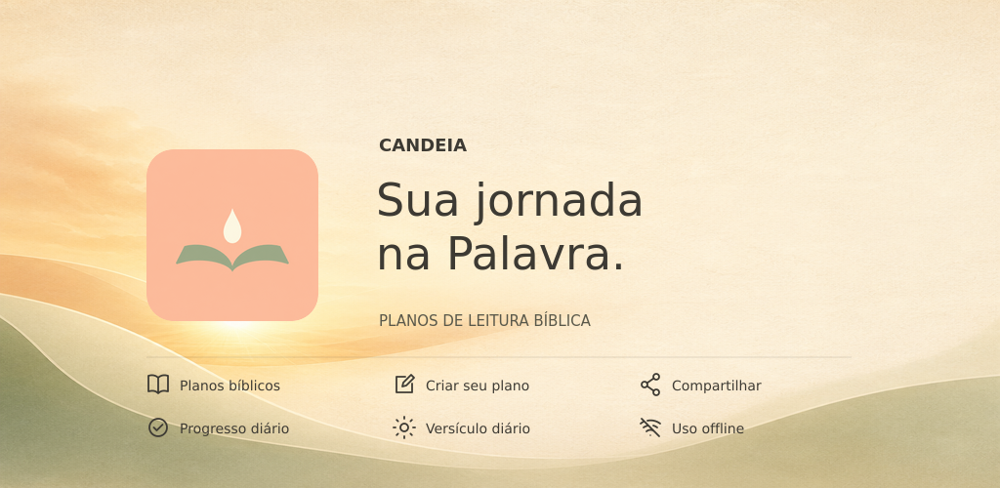

# Candeia
**Planos de leitura bíblica. Um dia de cada vez.**

Criar uma rotina de leitura não precisa ser complicado. A Candeia ajuda você a escolher um plano, saber o que ler e continuar de onde parou, sem precisar criar uma conta.

Use sua Bíblia física ou o formato que preferir. O aplicativo organiza as referências e acompanha sua jornada, para que você possa dedicar tempo à leitura, à reflexão e à prática.

## Conheça as funcionalidades

### Encontre um plano ou crie o seu

Explore a biblioteca com planos para a Bíblia completa ou partes dela, em diferentes durações e ordens de leitura. Use as tags para filtrar opções como Anual, Cronológico e Novo Testamento.

Você também pode criar e editar planos pessoais, selecionar suas tags e importar arquivos JSON compatíveis. Todo plano criado por você recebe a identificação de plano pessoal.

### Organize suas jornadas

Inicie uma jornada e marque as leituras conforme concluir. É possível acompanhar mais de um plano ao mesmo tempo.

As leituras concluídas ficam recolhidas, mantendo a última concluída à vista. As próximas aparecem em grupos de dez, e o último dia do plano continua disponível no fim da lista.

Precisou reorganizar a rotina? Ajuste o calendário da jornada a partir de hoje, sem apagar as leituras já registradas. As jornadas finalizadas permanecem no histórico de **Meus planos**.

### Acompanhe seu ritmo

Na tela de **Progresso**, consulte:

- O gráfico semanal de leitura, de domingo a sábado, com navegação entre semanas.
- Sua frequência de leitura.
- Uma estimativa de conclusão baseada no ritmo recente, considerando também os dias sem leitura.

Você pode acompanhar as jornadas em andamento juntas ou selecionar uma delas. A estimativa depende dos registros disponíveis: é uma referência para se organizar, não uma cobrança.

### Receba lembretes

Escolha os dias da semana e um ou mais horários por dia para lembrar da leitura.

Os lembretes são agendados no próprio aparelho e funcionam sem internet. É necessário permitir as notificações; restrições de bateria e configurações do sistema podem atrasar sua entrega.

### Tenha um versículo por perto

A Home apresenta um versículo em português, que fica disponível para consulta offline.

Com internet, puxe a tela inicial para baixo para tentar buscar outro versículo. Se a consulta não estiver disponível, o aplicativo mantém o versículo já carregado.

### Compartilhe e imprima

- Crie cartões de planos, jornadas, leituras diárias e versículos.
- Escolha o formato quadrado ou vertical, compartilhe a imagem, salve na galeria ou copie o texto.
- Exporte planos em PDF com **nomes completos dos livros** ou **nomes abreviados dos livros**.
- Exporte os planos criados ou importados por você em JSON compatível para compartilhar com outras pessoas.

Os planos incluídos no aplicativo podem ser impressos em PDF e compartilhados em cartões, mas não são exportados em JSON.

### Guarde uma cópia da sua jornada

Crie backups dos seus planos pessoais e das suas jornadas para guardar em um local seguro ou levar para outro aparelho.

**A restauração substitui os planos pessoais e as jornadas atuais pelos dados do arquivo, sem mesclar informações.** Antes de restaurar, faça uma cópia dos dados que deseja preservar.

Editar um plano pessoal não modifica as leituras nem as marcações das jornadas já iniciadas a partir dele.

## Como começar

1. **Abra a Biblioteca.** Explore os planos e use as tags para encontrar uma opção adequada à sua rotina.
2. **Inicie uma jornada.** Use o plano escolhido para acompanhar sua leitura.
3. **Separe sua Bíblia.** Consulte as referências do dia e faça a leitura no formato que preferir.
4. **Registre o que leu.** Marque as leituras concluídas para acompanhar seu avanço.
5. **Configure um lembrete.** Escolha dias e horários que façam sentido para você.
6. **Volte no seu ritmo.** Se precisar, ajuste o calendário e continue de onde parou.

## Dicas para a leitura e o devocional

- **Escolha um horário possível.** Uma rotina simples e sustentável costuma ajudar mais do que uma meta difícil de manter.
- **Use uma Bíblia física, se puder.** Ela pode ajudar a reduzir distrações e dar espaço para anotações e marcações.
- **Reserve um momento de reflexão.** Leia com atenção, ore e pense em como aplicar o que encontrou no texto.
- **Anote suas perguntas e aprendizados.** Um caderno pode acompanhar a jornada e ajudar nas próximas leituras.
- **Sublinhe com propósito.** Destaque passagens que deseja reler e procure observar seu contexto.
- **Retome sem tentar compensar tudo de uma vez.** Se perder um dia, continue. O calendário pode ser reorganizado sem apagar seu progresso.
- **Faça backups regularmente.** Seus dados ficam no aparelho; guardar uma cópia é importante antes de trocar de celular ou desinstalar o aplicativo.

Na Home, as dicas de leitura podem ser recolhidas e reabertas quando você quiser.

## Seus dados e o uso offline

Os planos pessoais e o progresso ficam armazenados localmente, sem sincronização automática em nuvem. O acompanhamento da leitura continua disponível sem internet.

A Candeia contém anúncios e utiliza serviços externos para algumas funções, como a consulta de versículos. Os anúncios dependem de conexão e não impedem o uso offline dos planos e do progresso.

Saiba mais na [Política de Privacidade](https://eduardongarcia.github.io/condo-encomendas-doc/candeia/privacy-policy).

---

**Candeia — Um dia de cada vez.**

 [@candeia.119](https://www.instagram.com/candeia.119/)
